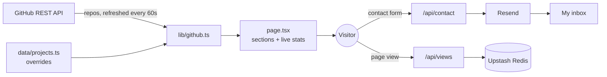

<div align="center">

# Daud Abdi — Data Engineering Portfolio

**Associate Data Engineer** building tested, containerised data pipelines with Python, SQL, dbt and Airflow.

**🌐 [daudabdi.com](https://daudabdi.com)**

[](https://daudabdi.com)
[](https://nextjs.org)
[](https://www.typescriptlang.org)
[](https://tailwindcss.com)
[](https://vercel.com)

</div>

---

This repository is the source code for my personal portfolio. It's a single-page site covering my data engineering projects, skills, certifications and experience, with a working contact form.

The Projects section is never edited by hand: it's built from my GitHub repositories at request time, so a new pipeline appears on the site shortly after I push it.

## Contents

- [Featured projects](#featured-projects)
- [Features](#features)
- [Tech stack](#tech-stack)
- [Architecture](#architecture)
- [Getting started](#getting-started)
- [Project structure](#project-structure)
- [How the Projects section works](#how-the-projects-section-works)
- [Updating content](#updating-content)
- [Deployment](#deployment)
- [Contact](#contact)

## Featured projects

A selection of the pipelines shown on the site. The full list is at [daudabdi.com](https://daudabdi.com/#projects).

| Project | What it does | Stack |
| --- | --- | --- |
| [London Crime Lakehouse](https://github.com/Daudsaid/london-crime-lakehouse) · [live](https://london-crime-lakehouse.streamlit.app/) | Medallion lakehouse over 3.44M police street-crime rows, reconciled back to the bronze count on every run, with a live dashboard for all 33 boroughs | PySpark, Delta Lake, pytest, GitHub Actions, Streamlit |
| [Sanctions Screening Pipeline](https://github.com/Daudsaid/sanctions-screening-pipeline) | Screens Companies House fund managers and officers against 23,271 UK and US sanctioned parties, with 93–96% recall at only 30 alerts | Python, PostgreSQL, dbt, rapidfuzz, GitHub Actions |
| [Real-time Crypto Lakehouse](https://github.com/Daudsaid/realtime-crypto-lakehouse) | Live Binance trades into a Delta medallion of 1-minute candles, verified across 762K trades with 0 gaps and 0 duplicates | Kafka, Spark Structured Streaming, Delta Lake, PostgreSQL |
| [TfL Disruptions Lakehouse](https://github.com/Daudsaid/tfl-disruptions-lakehouse) | Minute-by-minute Underground line status into disruption episodes, separating planned from unplanned disruption | Kafka, Spark Structured Streaming, Delta Lake, Streamlit |
| [Premier League Pipeline 2026/27](https://github.com/Daudsaid/premier-league-pipeline-2627) | Unattended twice-weekly ETL for the whole season, using Write-Audit-Publish and dead-lettering bad rows | Python, PostgreSQL, Pydantic, Alembic, GitHub Actions |

## Features

- **🔄 Projects synced from GitHub.** Repositories are fetched from the GitHub API and refreshed every 60 seconds. Curated overrides control titles, descriptions, tags and ordering, and a fallback renders the same list if the API is unavailable.
- **📊 Live stats.** The project count, pipeline count and years of experience are calculated from the project data and a start date, never typed in by hand.
- **✉️ Contact form.** Messages are delivered to my inbox through [Resend](https://resend.com).
- **👁️ View counter.** Page views are counted in [Upstash Redis](https://upstash.com).
- **🎨 Responsive design.** Dark theme built with Tailwind CSS, with section animations from Framer Motion.

## Tech stack

| Area | Technology |
| --- | --- |
| Framework | Next.js 16 (App Router, server components, incremental static regeneration) |
| Language | TypeScript |
| UI | React 18, Tailwind CSS 3, Framer Motion, React Icons |
| Email | Resend |
| Storage | Upstash Redis |
| Data source | GitHub REST API |
| Linting | ESLint 10 (flat config) with `eslint-config-next` |
| Hosting | Vercel |

## Architecture



The home page is statically generated and refreshed every 60 seconds. The two API routes run on demand.

## Getting started

### Prerequisites

- Node.js 20 or later
- npm

### Run locally

```bash
git clone https://github.com/Daudsaid/daud-portfolio-site.git
cd daud-portfolio-site
npm install
cp .env.local.example .env.local   # fill in the values below
npm run dev
```

Then open [http://localhost:3000](http://localhost:3000).

### Environment variables

| Variable | Needed for | Description |
| --- | --- | --- |
| `RESEND_API_KEY` | Contact form | API key used by `/api/contact` to send email |
| `UPSTASH_REDIS_REST_URL` | View counter | Upstash Redis REST endpoint |
| `UPSTASH_REDIS_REST_TOKEN` | View counter | Upstash Redis REST token |
| `GITHUB_TOKEN` | Optional | Raises the GitHub API rate limit |

All of these are optional for local development. Without them, the contact form returns an error, the view counter shows `0`, and projects fall back to the local list.

### Scripts

| Command | Description |
| --- | --- |
| `npm run dev` | Start the development server |
| `npm run build` | Create a production build |
| `npm run start` | Serve the production build |
| `npm run lint` | Lint the project with ESLint |

## Project structure

```text
app/
├── api/
│   ├── contact/route.ts    # POST: sends contact-form messages via Resend
│   └── views/route.ts      # GET/POST: reads and increments the view count
├── components/             # Page sections: Hero, About, Projects, Skills, …
├── data/
│   ├── projects.ts         # Project overrides, ordering and hidden repos
│   ├── skills.ts           # Skills grouped by category
│   └── certifications.ts   # Certification cards
├── lib/
│   ├── github.ts           # Fetches repos and merges them with overrides
│   └── experience.ts       # Derives the "years of experience" label
├── layout.tsx              # Root layout and SEO metadata
└── page.tsx                # Home page: assembles sections, computes stats
public/                     # Static assets (profile photo)
```

## How the Projects section works

[`app/lib/github.ts`](app/lib/github.ts) fetches my public repositories and decides which ones to show:

1. Forks, archived repos and anything in `hiddenRepos` are skipped.
2. A repo is shown if it has an entry in `projectOverrides` **or** carries the GitHub topic `portfolio`.
3. Override fields (title, description, tags, demo link, featured flag, category, order) take precedence over GitHub metadata. Without an override, the title comes from the repo name and the tags from its topics or primary language.
4. Projects are sorted by `order`, then by most recent push.

If the GitHub API request fails, the list is built from `projectOverrides` alone, so the section never renders empty.

**To add a project**, either:

- add the `portfolio` topic to the repository on GitHub. It appears within about a minute. Or:
- add an entry to `projectOverrides` in [`app/data/projects.ts`](app/data/projects.ts) to control its title, description, tags and position.

## Updating content

| To change… | Edit |
| --- | --- |
| Projects | [`app/data/projects.ts`](app/data/projects.ts) |
| Skills | [`app/data/skills.ts`](app/data/skills.ts) |
| Certifications | [`app/data/certifications.ts`](app/data/certifications.ts) |
| Experience timeline | [`app/components/Experience.tsx`](app/components/Experience.tsx) |
| Experience start date | `DE_START` in [`app/lib/experience.ts`](app/lib/experience.ts) |
| Page title and SEO description | `metadata` in [`app/layout.tsx`](app/layout.tsx) |

## Deployment

The site is deployed on [Vercel](https://vercel.com) at [daudabdi.com](https://daudabdi.com). Every push to `main` triggers a production deploy.

To deploy your own copy:

1. Import the repository into Vercel.
2. Add the environment variables above in the project settings.
3. Deploy. The home page revalidates every 60 seconds, so GitHub changes show up without a redeploy.

## Contact

- 🌐 Website: [daudabdi.com](https://daudabdi.com)
- 💼 LinkedIn: [daudabdi0506](https://linkedin.com/in/daudabdi0506)
- 🐙 GitHub: [@Daudsaid](https://github.com/Daudsaid)

---

<div align="center">
<sub>Designed and built by Daud Abdi.</sub>
</div>
